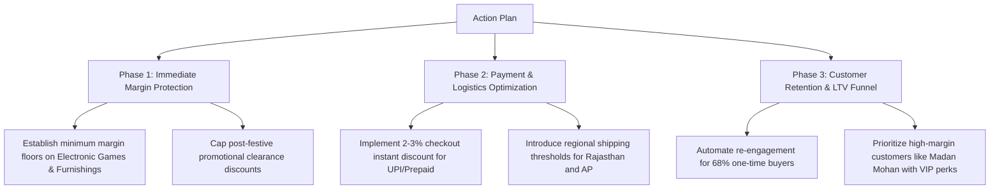

# Executive Business Intelligence Report
## E-Commerce Store Performance & Profitability Diagnostic (FY 2018)

---

## Executive Summary

An exhaustive analysis of 500 orders (1,500 line items) across Indian e-commerce retail in 2018 reveals total gross revenue of **₹437,771** and net profit of **₹36,963** (an overall net profit margin of **8.44%**). 

While top-line sales figures appear steady, a granular financial diagnostic uncovers severe underlying margin leakage: **35.3% of all transactions operated at a loss**, destroying **₹38,079** in profits. Addressing these loss-making drivers would increase bottom-line profitability by **103% (to ₹75,042)** without acquiring any new customers.

```
+-----------------------------------------------------------------------------------------+
|                                    FINANCIAL OVERVIEW                                    |
+-----------------------------------------------------------------------------------------+
| Total Revenue      : ₹437,771.00     | Distinct Orders    : 500                         |
| Net Profit         : ₹36,963.00      | Distinct Customers : 336                         |
| Net Margin         : 8.44%           | Total Units Sold   : 5,615                       |
| True AOV           : ₹875.54         | Avg Unit Price     : ₹77.96                      |
| Profitable Gains   : +₹75,042.00     | Loss Bleed         : -₹38,079.00 (529 items)     |
+-----------------------------------------------------------------------------------------+
```

---

## 1. The Five Critical Strategic Findings

### 1. The Sub-Category Margin Bleed
While categories like **Electronics** and **Clothing** generate significant volume, individual sub-categories have deeply negative economics:

| Sub-Category | Category | Total Revenue (₹) | Net Profit (₹) | Margin (%) | Loss Items (%) | Strategic Recommendation |
| :--- | :--- | :---: | :---: | :---: | :---: | :--- |
| **Printers** | Electronics | ₹59,252 | **+₹8,606** | 14.5% | 22.4% | Core Hero Product; bundle with ink/accessories |
| **Bookcases** | Furniture | ₹56,861 | **+₹6,516** | 11.5% | 25.3% | High margin; expand catalog variations |
| **Saree** | Clothing | ₹59,094 | **+₹4,057** | 6.9% | 34.8% | High volume; improve supplier sourcing terms |
| **Electronic Games** | Electronics | ₹39,168 | **-₹644** | -1.6% | 39.5% | Stop aggressive discounting; audit vendor COGS |
| **Furnishings** | Furniture | ₹13,484 | **-₹806** | -6.0% | 46.2% | Liquidate negative SKUs or set minimum cart values |
| **Kurti** | Clothing | ₹3,361 | **-₹401** | -11.9% | 44.4% | Review return/clearance pricing floor |
| **Skirt** | Clothing | ₹1,946 | **-₹315** | -16.2% | 50.0% | Unviable unit margins; reprice or discontinue |
| **Leggings** | Clothing | ₹2,106 | **-₹130** | -6.2% | 47.6% | Bundle as add-ons to Sarees rather than standalone |

---

### 2. High Cash-On-Delivery (COD) Exposure
Payment distribution demonstrates typical Indian consumer trends, but highlights significant working capital risks:
- **Cash on Delivery (COD)**: **35.4%** of revenue (₹155,181) and **44%** of total unit volume.
- **Credit Card**: 19.9% (₹86,932)
- **EMI**: 17.8% (₹77,881)
- **UPI**: 15.7% (₹68,641)
- **Debit Card**: 11.2% (₹49,136)

> **Risk Assessment**: In Indian e-commerce, COD orders suffer 25–40% higher Return to Origin (RTO) failure rates and incur carrier handling surcharges. A store carrying over 35% COD volume with no automated address verification or prepaid conversion incentive is bleeding hidden shipping fees.

---

### 3. The Geographic Margin Discrepancy & "The Mumbai Paradox"
A comparison across top metropolitan hubs reveals drastic differences in profitability:

```
State Performance:
• Maharashtra    : ₹102,498 Sales | ₹6,963 Profit  (6.8% Margin)
• Madhya Pradesh : ₹87,463 Sales  | ₹7,382 Profit  (8.4% Margin)
• Uttar Pradesh  : ₹38,362 Sales  | ₹3,358 Profit  (8.8% Margin)
• Delhi          : ₹22,957 Sales  | ₹1,958 Profit  (8.5% Margin)
• Rajasthan      : ₹22,334 Sales  | -₹323 Profit   (-1.4% Margin)  <-- LOSS ZONE
• Andhra Pradesh : ₹13,256 Sales  | -₹280 Profit   (-2.1% Margin)  <-- LOSS ZONE
```

#### The Mumbai vs. Pune Anomaly:
- **Mumbai**: Generated **₹58,886** in sales (#2 city nationally), but produced only **₹803 in net profit (1.4% margin)**.
- **Pune**: Generated **₹43,612** in sales, but yielded **₹6,160 in net profit (14.1% margin)**—**7.7x more profit** on lower sales!
- **Root Cause**: Orders in Mumbai heavily favored discounted electronics and loss-making apparel SKUs.

---

### 4. Seasonality and the Four "Cash-Drain" Months
Tracking performance month-over-month shows extreme volatility in profit margins:

| Month | Orders | Revenue (₹) | Net Profit (₹) | Margin (%) | Status |
| :--- | :---: | :---: | :---: | :---: | :--- |
| **January** | 61 | ₹61,632 | +₹9,684 | 15.7% | Profitable |
| **February** | 54 | ₹38,962 | +₹8,465 | 21.7% | Highly Profitable |
| **March** | 58 | ₹60,694 | +₹7,793 | 12.8% | Profitable |
| **April** | 44 | ₹34,330 | +₹4,192 | 12.2% | Moderate Profit |
| **May** | 31 | ₹29,093 | **-₹3,730** | **-12.8%** | **Severe Loss** |
| **June** | 30 | ₹23,658 | +₹420 | 1.8% | Breakeven |
| **July** | 31 | ₹12,966 | **-₹2,138** | **-16.5%** | **Severe Loss** |
| **August** | 31 | ₹31,492 | +₹2,068 | 6.6% | Moderate Profit |
| **September**| 30 | ₹27,283 | **-₹1,399** | **-5.1%** | **Loss** |
| **October** | 43 | ₹31,613 | +₹2,959 | 9.4% | Festive Ramp-up |
| **November** | 46 | ₹48,469 | **+₹10,253** | **21.2%** | **Peak Season** (Diwali) |
| **December** | 41 | ₹37,579 | **-₹1,604** | **-4.3%** | **Loss** (Post-Festive Clearance) |

**Insight**: Promotional clearance sales in May, July, and December eroded entire months of operational profitability. Clear discounting rules must be implemented.

---

### 5. Customer Loyalty & The Revenue Trap
- **Single-Purchase Customers**: **229 (68.2%)**
- **Repeat Customers**: **107 (31.8%)**
- **Top Spender Illusion**:
  - Customer **Harivansh** generated ₹9,902 in gross sales, but resulted in **-₹157 in net losses**.
  - Customer **Madan Mohan** generated ₹7,766 in gross sales, but returned **+₹2,166 in net profit (27.9% margin)**.
  - Relying exclusively on gross revenue blinds sales teams to profitability drivers.

---

## 2. Immediate Tactical Action Plan



1. **Implement Price Floors on Negative SKUs**:
   - Re-evaluate contract terms for *Electronic Games* (-1.6% margin) and *Furnishings* (-6.0% margin). Increase prices by 5–8% or bundle them with high-margin items (e.g., bundle video games with console accessories).

2. **Incentivize Prepaid Orders**:
   - Provide an instant 3% discount or cashback for UPI and Credit Card orders to nudge customers away from COD (35.4%), reducing return risks.

3. **Regional Shipping Optimization**:
   - Apply nominal delivery fees on orders shipped to Rajasthan and Andhra Pradesh, or establish higher minimum order thresholds (e.g., ₹999 free shipping) to turn those geographies profitable.

4. **Retention Marketing Funnel**:
   - Build automated 14-day and 30-day post-delivery cross-selling campaigns for clothing buyers (e.g., matching Stoles/Accessories with Sarees) to boost the 31.8% repeat customer rate.
