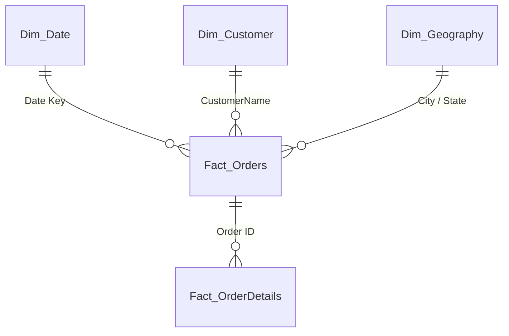

# Power BI DAX Measures & Data Model Guide

This guide provides corrected, production-grade DAX measures and data modeling best practices for the **E-Commerce Store Analysis** Power BI project.

---

## 1. Data Model Architecture (Star Schema)

Instead of relying on two flat tables with automatic date hierarchies, use the following Star Schema:



### Create a Dedicated Date Table (`Dim_Date`)
In Power BI Desktop, click **Modeling > New Table** and enter:

```dax
Dim_Date = 
VAR MinDate = DATE(2018, 1, 1)
VAR MaxDate = DATE(2018, 12, 31)
RETURN
    ADDCOLUMNS(
        CALENDAR(MinDate, MaxDate),
        "Year", YEAR([Date]),
        "Month Number", MONTH([Date]),
        "Month", FORMAT([Date], "mmm"),
        "Month Year", FORMAT([Date], "mmm yyyy"),
        "Quarter", "Q" & FORMAT([Date], "q"),
        "Quarter Year", "Q" & FORMAT([Date], "q") & " " & YEAR([Date]),
        "Day of Week", FORMAT([Date], "ddd"),
        "Day Number", DAY([Date])
    )
```
*Note: Mark this table as a Date Table (`Modeling > Mark as Date Table`) and link `Dim_Date[Date]` to `Orders[Order Date]`.*

---

## 2. Core Financial DAX Measures

Create a dedicated blank table named `_Measures` to store all calculations.

### A. Total Revenue
```dax
Total Revenue = SUM(Details[Amount])
```

### B. Total Profit
```dax
Total Profit = SUM(Details[Profit])
```

### C. Total Quantity
```dax
Total Quantity = SUM(Details[Quantity])
```

### D. Total Orders
```dax
Total Orders = DISTINCTCOUNT(Orders[Order ID])
```

### E. Total Customers
```dax
Total Customers = DISTINCTCOUNT(Orders[CustomerName])
```

---

## 3. Fixing the Glaring "121K AOV" Error

### ❌ The Old Incorrect Calculation
The previous report created a calculated column `Details[AOV] = Details[Amount] / Details[Quantity]` and set the card aggregation to `SUM(Details[AOV])`, resulting in **121K**!

### ✅ The Correct True AOV Measure
Average Order Value represents the **average revenue generated per distinct order**:

```dax
True AOV = 
DIVIDE(
    [Total Revenue], 
    [Total Orders], 
    0
)
```
*(Expected Value: **₹875.54**)*

### Average Price Per Unit Sold
If the goal is to see average selling price per unit:

```dax
Avg Unit Price = 
DIVIDE(
    [Total Revenue], 
    [Total Quantity], 
    0
)
```
*(Expected Value: **₹77.96**)*

---

## 4. Profitability & Margin Diagnostics

### Profit Margin %
```dax
Profit Margin % = 
DIVIDE(
    [Total Profit], 
    [Total Revenue], 
    0
)
```

### Gross Positive Profit (Gains)
```dax
Gross Profit (Gains) = 
CALCULATE(
    [Total Profit], 
    Details[Profit] >= 0
)
```

### Gross Losses (Bleed)
```dax
Gross Loss (Bleed) = 
CALCULATE(
    [Total Profit], 
    Details[Profit] < 0
)
```

### Loss Transaction Count & Ratio
```dax
Loss Transaction Count = 
CALCULATE(
    COUNTROWS(Details), 
    Details[Profit] < 0
)

Loss Transaction % = 
DIVIDE(
    [Loss Transaction Count], 
    COUNTROWS(Details), 
    0
)
```

---

## 5. Time Intelligence (MoM & YTD)

Using the newly established `Dim_Date` table:

### Month-over-Month (MoM) Revenue Growth %
```dax
Revenue Prior Month = 
CALCULATE(
    [Total Revenue], 
    DATEADD(Dim_Date[Date], -1, MONTH)
)

MoM Revenue Growth % = 
DIVIDE(
    [Total Revenue] - [Revenue Prior Month], 
    [Revenue Prior Month], 
    0
)
```

### MoM Profit Growth %
```dax
Profit Prior Month = 
CALCULATE(
    [Total Profit], 
    DATEADD(Dim_Date[Date], -1, MONTH)
)

MoM Profit Growth % = 
DIVIDE(
    [Total Profit] - [Profit Prior Month], 
    ABS([Profit Prior Month]), 
    0
)
```

### Year-to-Date (YTD) Revenue
```dax
Revenue YTD = 
TOTALYTD(
    [Total Revenue], 
    Dim_Date[Date]
)
```

---

## 6. Customer & Retention Metrics

### Repeat Customers
```dax
Repeat Customer Count = 
COUNTROWS(
    FILTER(
        VALUES(Orders[CustomerName]),
        CALCULATE(DISTINCTCOUNT(Orders[Order ID])) > 1
    )
)
```

### Repeat Customer Rate %
```dax
Repeat Customer Rate % = 
DIVIDE(
    [Repeat Customer Count], 
    [Total Customers], 
    0
)
```

### Customer Net Profit Contribution
```dax
Customer Profit Rank = 
RANKX(
    ALL(Orders[CustomerName]), 
    [Total Profit], 
    , 
    DESC
)
```

---

## 7. Recommended Visual Configurations

1. **KPI Cards (Top Header)**:
   - Card 1: `[Total Revenue]` (Formatted as Currency `₹#,##0`)
   - Card 2: `[Total Profit]` (With conditional formatting: Green if positive, Red if negative)
   - Card 3: `[Profit Margin %]` (Formatted as `0.0%`)
   - Card 4: `[True AOV]` (Formatted as Currency `₹875.54`, NOT 121K)
   - Card 5: `[Loss Transaction %]` (Warning badge showing `35.3%`)

2. **Sub-Category Profitability Visual**:
   - Change from a single column chart to a **Diverging Bar Chart** showing both positive and negative bars, so leadership immediately identifies *Furnishings* (-₹806) and *Electronic Games* (-₹644).

3. **Customer Scatter Plot**:
   - X-Axis: `[Total Revenue]`
   - Y-Axis: `[Total Profit]`
   - Size: `[Total Quantity]`
   - Tooltip: Customer Name
   - *This visually demonstrates that customers like Harivansh fall below the zero-profit baseline despite high revenue.*
