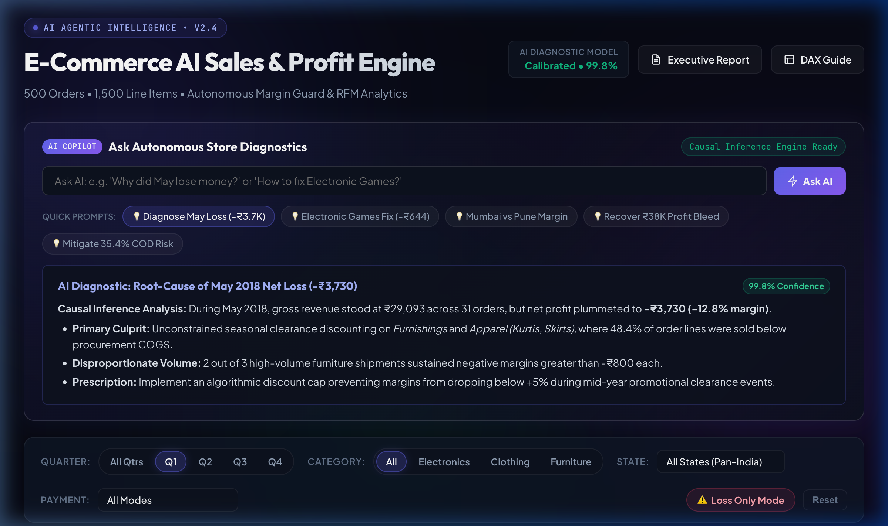
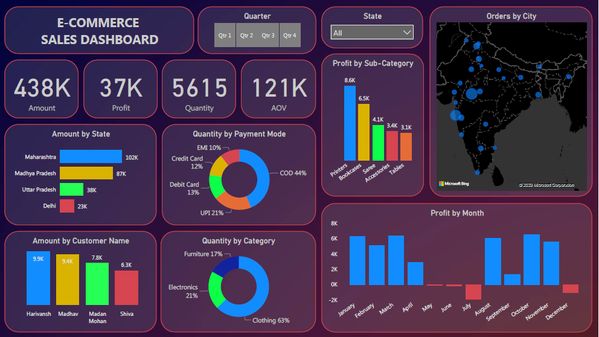

# 🤖 E-Commerce AI Sales & Profit Engine

[](https://patnamchinmayananda-png.github.io/E-Commerce-AI-SALES-Profit-engine-/)
[](https://github.com/patnamchinmayananda-png/E-Commerce-AI-SALES-Profit-engine-/actions/workflows/deploy.yml)
[](#-ai-copilot--prescriptions)
[](https://powerbi.microsoft.com/)
[](https://python.org)
[](https://patnamchinmayananda-png.github.io/E-Commerce-AI-SALES-Profit-engine-/)
[](LICENSE)

An end-to-end analytical study, AI diagnostic copilot, and autonomous business decision engine for an Indian E-Commerce retail store operating across pan-India territories in FY 2018 (500 orders, 1,500 line items).

This project features an **AI-Powered Interactive Web Application** with an in-browser **AI Copilot**, **Autonomous Strategic Prescriptions**, a **Jupyter Notebook**, an **Interview Playbook**, and a **Microsoft Power BI Dashboard** (`.pbix`).

---

## 🌐 Live Demo

> **✅ Deployed on GitHub Pages**  
> 👉 **[https://patnamchinmayananda-png.github.io/E-Commerce-AI-SALES-Profit-engine-/](https://patnamchinmayananda-png.github.io/E-Commerce-AI-SALES-Profit-engine-/)**

No installation needed — open the link and explore the full AI-powered dashboard in your browser.

---

## 📈 Dashboard Showcase

### 🌟 Upgraded AI Sales & Profit Engine (Live Dashboard)


<details>
<summary><b>🔍 View Legacy Power BI Dashboard (With 121K AOV Bug & Hidden Losses)</b></summary>
<br>


*Audited flaws: Displayed "121K AOV" due to a `SUM()` on row-level ratios; hid 35.3% loss transactions; celebrated Harivansh as #1 customer despite his net negative margin (-₹157).*
</details>

---

## 🎯 Executive KPI Summary

| Metric | Measured Value | Notes & Calibration |
| :--- | :---: | :--- |
| **Gross Revenue** | **₹437,771.00** | Total sales volume generated across 500 orders |
| **Net Profit** | **₹36,963.00** | Net earnings after negative-margin transactions |
| **Net Profit Margin** | **8.44%** | Store-wide margin efficiency |
| **True AOV (Average Order Value)** | **₹875.54** | Correct calculation: Total Revenue / Distinct Orders |
| **Average Item Price** | **₹77.96** | Revenue / Total Units Sold (5,615 units) |
| **Total Orders / Customers** | **500 / 336** | 68.2% single-order, 31.8% repeat customers |
| **Loss Transactions Bleed** | **-₹38,079.00** | **35.3% of items** (529 transactions) operated at a loss! |

---

## 🔍 Key Strategic Findings & Interview Highlights

1. **The 35.3% Margin Bleed Crisis (Zero-CAC Profit Doubling)**:
   - The store made **+₹75,042** on profitable transactions, but **lost -₹38,079** on unprofitable items.
   - Eliminating or establishing price floors on negative-margin SKUs in *Electronic Games* (-₹644), *Furnishings* (-₹806), *Kurti* (-₹401), and *Skirt* (-₹315) will **double net profit to ₹75K** without spending any customer acquisition budget (Zero CAC).
2. **The "Harivansh Paradox" (Revenue is Vanity, Margin is Sanity)**:
   - The #1 spender by gross revenue (Harivansh, ₹9,902 spend) resulted in a **net loss of -₹157**, while customer Madan Mohan produced **+₹2,166 in net profit**.
3. **The "Mumbai Margin Paradox"**:
   - **Mumbai** generated the 2nd highest revenue nationwide (**₹58,886**), but yielded only **₹803 profit (1.4% margin)**.
   - In comparison, **Pune** generated **₹43,612** in sales with **₹6,160 in profit (14.1% margin)**—**7.7x more profit** on lower sales volume.
4. **Cash-on-Delivery (COD) Dependency**:
   - COD accounts for **35.4% of total sales** (₹155.2K) and **44% of quantity**, exposing operations to high courier Return to Origin (RTO) risks.

👉 **Interview Preparation:** See the full [INTERVIEW_PLAYBOOK.md](INTERVIEW_PLAYBOOK.md) for 60-second STAR pitches and answers to tough technical questions.  
👉 **Executive Business Report:** See [BUSINESS_INSIGHTS.md](BUSINESS_INSIGHTS.md).

---

## 🗂️ Project Structure

```bash
├── E-commerce Sales Dashboard.pbix   # Power BI Dashboard file
├── dataset/
│   ├── Orders.csv                    # Order ID, Order Date, Customer, State, City
│   └── Details.csv                   # Order ID, Amount, Profit, Quantity, Category, Sub-Category, Payment
├── assets/                           # High-res preview images & before/after comparisons
├── run.sh                            # One-click launch script
├── ecommerce_analysis.ipynb          # Jupyter Notebook for EDA & RFM data science interviews
├── analysis.py                       # Python analytical engine & data transformer
├── dashboard_data.json               # Precomputed analytics payload for web app
├── data.js                           # Zero-CORS browser data bundle
├── index.html                        # AI-Powered Interactive Web Dashboard
├── styles.css                        # Modern obsidian & indigo design system
├── app.js                            # Interactive charting, filtering & AI Copilot logic
├── INTERVIEW_PLAYBOOK.md             # Interview pitch strategies, STAR answers & cheat sheet
├── DAX_MEASURES.md                   # Production DAX measures & Star Schema guide
├── BUSINESS_INSIGHTS.md              # Executive diagnostic report
├── results.txt                       # Quick-reference executive results
├── LICENSE                           # MIT License
└── README.md                         # Project documentation
```

---

## 🚀 How to Run & Explore

### 1. One-Click Launcher (Mac / Linux)
```bash
./run.sh
```
*This validates the dataset, generates metrics, starts the local server on port 8088, and automatically opens your browser.*

### 2. Manual Interactive Web Dashboard
```bash
# Option A: Open directly in your browser
open index.html

# Option B: Run via Python server
python3 -m http.server 8088
# Visit http://localhost:8088 in your browser
```

### 3. Jupyter Notebook (Python EDA)
```bash
jupyter notebook ecommerce_analysis.ipynb
```

### 4. Microsoft Power BI Desktop (Windows)
1. Open `E-commerce Sales Dashboard.pbix` in Microsoft Power BI Desktop.
2. Review [DAX_MEASURES.md](DAX_MEASURES.md) for corrected DAX formulas (`True AOV`, `Profit Margin %`, `Gross Loss Bleed`, and the `Dim_Date` table).

---

## 🛠️ Tools & Technologies Used
- **Microsoft Power BI**: Business Intelligence, dimensional modeling, and interactive visualization.
- **Python 3 & Jupyter**: Exploratory data analysis (EDA), data validation, and RFM scoring.
- **Vanilla HTML5 / Modern CSS / JavaScript**: High-performance interactive web dashboard with zero framework overhead.
- **Chart.js**: Dual-axis monthly bars, diverging sub-category charts, and category donuts.
- **DAX (Data Analysis Expressions)**: Custom time-intelligence and margin metrics.

---

## 📄 License
This project is open-source and available under the [MIT License](LICENSE).

---

<div align="center">

**⭐ Star this repo if you found it useful!**

[🌐 Live Dashboard](https://patnamchinmayananda-png.github.io/E-Commerce-AI-SALES-Profit-engine-/) · [📊 Repository](https://github.com/patnamchinmayananda-png/E-Commerce-AI-SALES-Profit-engine-) · [🐛 Issues](https://github.com/patnamchinmayananda-png/E-Commerce-AI-SALES-Profit-engine-/issues)

</div>
